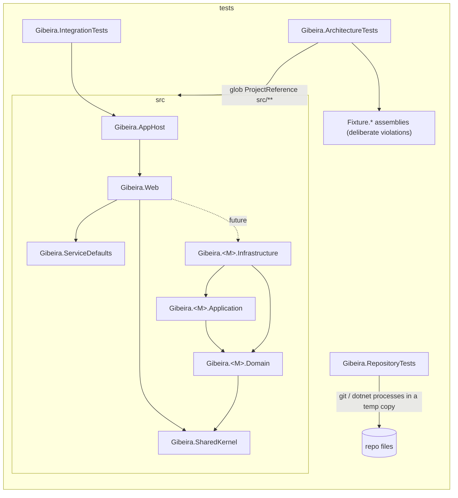
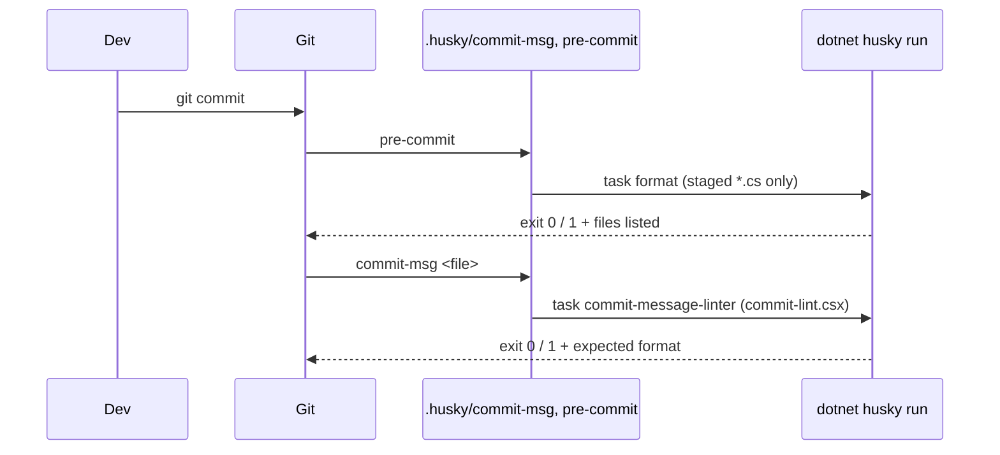

# Monorepo Scaffold Design

**Spec**: `.specs/features/001-monorepo-scaffold/spec.md`
**Status**: Approved

---

## Architecture Overview

One solution, `Gibeira.slnx`. Production code lives in `src/`, tests in `tests/`, the module template in `templates/`. Modules are absent; the rules that will govern them are live from day one and proven against fixture assemblies.

---

## Code Reuse Analysis

Empty repository: nothing to reuse in-repo. External building blocks:

| Component | Source | How to use |
| --------- | ------ | ---------- |
| Blazor Web App template | `dotnet new blazor --interactivity Server` (SDK 10.0.403) | Generate `Gibeira.Web`, then trim sample pages |
| Aspire AppHost / ServiceDefaults | `Aspire.AppHost.Sdk` 13.6.4, `aspire-servicedefaults` template shape | AppHost with one `web` project resource; ServiceDefaults with OpenTelemetry, health checks, resilience |
| Aspire testing | `Aspire.Hosting.Testing` 13.6.4 | Start the AppHost in tests, call `web` over its `http` endpoint |
| ArchUnitNET | `TngTech.ArchUnitNET.xUnitV3` 0.13.5 | Load assemblies, express dependency rules |
| xUnit v3 | `xunit.v3.mtp-v2` 4.0.2 on Microsoft.Testing.Platform | All test projects |
| Husky.Net | `husky` 0.9.1 local tool (ships `net10.0`) | Git hooks, task runner, `csx` script for commit-lint |

### Integration Points

| System | Method |
| ------ | ------ |
| git | Husky.Net sets `core.hooksPath=.husky` during `dotnet restore` (MSBuild target from `dotnet husky attach`) |
| dotnet new | Template package folder `templates/module`, installed with `dotnet new install ./templates/module` |

---

## Components

### Build configuration (repo root)

- **Purpose**: One place for framework, strictness, package versions and style.
- **Location**: `global.json`, `Directory.Build.props`, `Directory.Packages.props`, `.editorconfig`, `.gitattributes`, `.gitignore`
- **Interfaces**:
  - `global.json`: SDK `10.0.403`, `rollForward: latestFeature`; `msbuild-sdks: { Aspire.AppHost.Sdk: 13.6.4 }`; `test.runner: Microsoft.Testing.Platform`
  - `Directory.Build.props`: `TargetFramework net10.0`, `Nullable enable`, `ImplicitUsings enable`, `TreatWarningsAsErrors true`, `EnforceCodeStyleInBuild true`, `AnalysisLevel latest-recommended`, `ManagePackageVersionsCentrally true`
- **Dependencies**: none

### Gibeira.SharedKernel

- **Purpose**: Home for cross-module primitives (empty now).
- **Location**: `src/Shared/Gibeira.SharedKernel/`
- **Dependencies**: none

### Gibeira.ServiceDefaults

- **Purpose**: `AddServiceDefaults()` (OpenTelemetry, service discovery, resilience, health checks) and `MapDefaultEndpoints()` (`/health`, `/alive`).
- **Location**: `src/Shared/Gibeira.ServiceDefaults/`
- **Interfaces**: `IHostApplicationBuilder AddServiceDefaults(this IHostApplicationBuilder)`; `WebApplication MapDefaultEndpoints(this WebApplication)`
- **Reuses**: Aspire ServiceDefaults template shape

### Gibeira.Web

- **Purpose**: Blazor Web App, Interactive Server; one home page showing "Gibeira".
- **Location**: `src/Host/Gibeira.Web/`
- **Dependencies**: ServiceDefaults, SharedKernel
- **Loopback**: `launchSettings.json` URLs use `localhost`; under Aspire the endpoints are allocated on `localhost`.

### Gibeira.AppHost

- **Purpose**: `dotnet run --project src/Host/Gibeira.AppHost` starts the dashboard and the `web` resource.
- **Location**: `src/Host/Gibeira.AppHost/`
- **Interfaces**: `builder.AddProject<Projects.Gibeira_Web>("web")`

### Architecture rules

- **Purpose**: Each spec rule as a reusable function over a loaded architecture and a root prefix (`Gibeira` for the real solution, `Fixture` for violations).
- **Location**: `tests/Gibeira.ArchitectureTests/`
- **Interfaces**:
  - `SolutionArchitecture.Load(string prefix)`: loads every `<prefix>.*.dll` in the test output directory
  - `ModuleMap`: groups assemblies matching `^<prefix>\.(?<module>[A-Za-z0-9]+)\.(Domain|Application|Infrastructure)$` by module
  - One test class per rule group; each rule has a `passes_on_solution` and a `fails_on_fixture` test asserting the offending type name in the violation message
- **Module discovery (ARCH-08)**: the `.csproj` holds `<ProjectReference Include="../../src/Modules/**/*.csproj" />` plus explicit references to the four fixed projects; a new module is built into the test output and loaded with no test edit.
- **Naming rule (ARCH-07)**: walks `src/Modules/<Module>/**/*.csproj` from the repo root (found by locating `Gibeira.slnx`); the fixture case writes bad `.csproj` names to a temp folder.

### Fixture assemblies

- **Purpose**: Deliberate violations so every rule is proven to fail.
- **Location**: `tests/Gibeira.ArchitectureTests.Fixtures/`
- **Projects** (no project references a real `Gibeira.*` assembly):

| Project | Violates |
| ------- | -------- |
| `Fixture.Ledger.Infrastructure` | (target only) |
| `Fixture.Ledger.Application` → Infrastructure | ARCH-02 |
| `Fixture.Ledger.Domain` → Application, uses `Microsoft.AspNetCore.*`, uses fake `Microsoft.EntityFrameworkCore.*` type, uses `Fixture.Budgets.Domain` | ARCH-01, ARCH-03, ARCH-04 |
| `Fixture.Budgets.Domain` | (target only) |
| `Fixture.Web` | (target only) |
| `Fixture.SharedKernel` → `Fixture.Budgets.Domain`, `Fixture.Web` | ARCH-05, ARCH-06 |

The fake EF Core namespace lives in `Fixture.Fakes` so no EF Core package enters the repo.

### Commit hooks

- **Location**: `.config/dotnet-tools.json`, `.husky/commit-msg`, `.husky/pre-commit`, `.husky/task-runner.json`, `.husky/csx/commit-lint.csx`
- **commit-msg**: shell hook checks `command -v dotnet` (prints `dotnet SDK not found: install .NET 10 to commit` and exits 1), then `dotnet husky run --name commit-message-linter --args "$1"`. The csx reads the first line and matches
  `^(feat|fix|docs|style|refactor|perf|test|build|ci|chore|revert)(\([a-z0-9-]+\))?!?: \S.*$` with length ≤ 100, or `^Merge ` / `^Revert "`.
- **pre-commit**: same `dotnet` guard, then `dotnet husky run --name format`; task `sh .husky/format-staged.sh` with `include: ["**/*.cs"]`. The script lists the staged `.cs` files from git, exits 0 when there are none, and runs `dotnet format Gibeira.slnx --verify-no-changes --include` over them, swapping each file whose working copy differs from the index for a copy of its staged blob (changed after verification: Husky.Net 0.9.1 passes both its staged copy and the working-tree path).
- **Install on restore**: `dotnet husky attach tests/Gibeira.ArchitectureTests/Gibeira.ArchitectureTests.csproj` adds the target that runs `dotnet tool restore` and `dotnet husky install` before restore. It is idempotent (`git config` overwrite).

### Repository tests

- **Purpose**: Prove hooks, template, structure and docs through real `git` and `dotnet` processes.
- **Location**: `tests/Gibeira.RepositoryTests/`
- **Interfaces**: `TempRepo` fixture: copies the working tree (excluding `.git`, `bin`, `obj`) to a temp dir, runs `git init`, `dotnet restore`; helpers `Commit(message)`, `Stage(path, content)`, `Run(cmd)`.
- **Template tests** use `dotnet new install ... --debug:custom-hive <temp>` so the user's global template list is untouched.

### Module template

- **Location**: `templates/module/.template.config/template.json`, `templates/module/src/Modules/ModuleName/Gibeira.ModuleName.{Domain,Application,Infrastructure}/*.csproj`
- **Interfaces**: `shortName: gibeira-module`, `sourceName: ModuleName`, run from repo root without `-o`.

---

## Error Handling Strategy

| Error scenario | Handling | User impact |
| -------------- | -------- | ----------- |
| Bad commit header | csx exits 1 with the expected format and an example | Commit aborted, message explains format |
| Unformatted staged `.cs` | `dotnet format` exits non-zero, lists files | Commit aborted; run `dotnet format` |
| `dotnet` missing in hook | Guard prints the missing command | Commit aborted with a clear message |
| Architecture violation | ArchUnitNET failure lists offending types | `dotnet test` fails |

---

## Risks & Concerns

| Concern | Location | Impact | Mitigation |
| ------- | -------- | ------ | ---------- |
| Rules pass vacuously with zero modules | `tests/Gibeira.ArchitectureTests` | False confidence | Every rule has a fixture test that must fail |
| `dotnet format --include` reads the working tree, not the staged blob | `.husky/format-staged.sh` | A partially staged file is judged by its working copy | The script checks a copy of the staged blob instead (C37) |
| Hooks are bypassable with `--no-verify` | git | Bad commits possible | Accepted: CI is out of scope |
| Repository tests spawn `dotnet` and `git`; slow (~1-2 min) | `tests/Gibeira.RepositoryTests` | Slower `dotnet test` | One shared `TempRepo` per test class; arch tests stay fast as the quick gate |
| Aspire test needs the dev certificate untrusted-safe path | `tests/Gibeira.IntegrationTests` | TLS failures | Tests call the `http` endpoint |
| `/health` mapped only in Development by the Aspire default | `ServiceDefaults` | SCAF-05 fails outside Development | AppHost runs `web` in Development; integration test asserts it |

---

## Tech Decisions

| Decision | Choice | Rationale |
| -------- | ------ | --------- |
| Test platform | Microsoft.Testing.Platform (`global.json test.runner`) | Zero tests selected exits with code 8, so a proof whose filter matches nothing fails instead of passing silently |
| Rule parametrization | Rules take a name prefix | Real and fixture assemblies co-exist in one test output without colliding |
| Husky attach target | `Gibeira.ArchitectureTests.csproj` | The enforcement project; attaching to one project avoids parallel installs |
| Commit lint in C# (csx) | `commit-lint.csx` | Keeps tooling .NET-only, matches Husky.Net docs |

Project-level decisions recorded in `.specs/STATE.md`: AD-001 (modular monolith, module isolation), AD-002 (rules proven against fixture assemblies).
