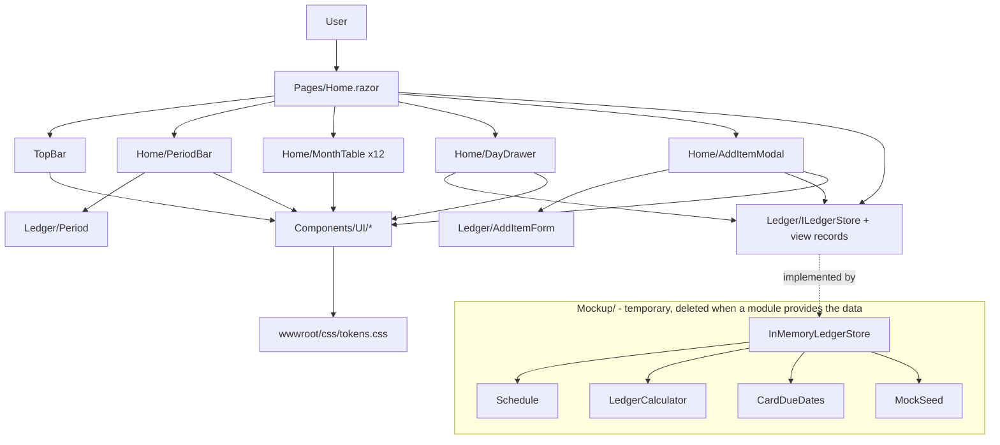

# Home Page Design

**Spec**: `.specs/features/002-home-page/spec.md`
**Status**: Approved
**Approved**: 2026-10-30 - user: "ok, approved to move to tasks"

---

## Architecture Overview

**Everything except the frontend is a temporary mockup (AD-007).** The user: "any logic other than the frontend is temporary to display the frontend mockup". The page and its components are the product of this feature. The data, the sums, the saldos, the repetitions and the card due dates exist only so the page has something real-looking to show. They live in one folder, `Gibeira.Web/Mockup/`, behind one interface, `ILedgerStore`. That folder and its tests are deleted when a finance module provides the data. None of it is a domain model, none of it sets a pattern, and none of it moves into a module.

The frontend talks only to `Ledger/ILedgerStore` and the view records next to it. The interface asks for what the screen draws (month tables, a day's entries, a card's due dates) rather than for raw items, so the page holds no ledger arithmetic. Asked "where should the ledger rules live?", the user chose "Plain C# in Gibeira.Web (Recommended)", and the mockup is that plain C#.

The app keeps Interactive Server rendering. `ILedgerStore` is registered **scoped**, so each circuit (browser tab) gets its own `InMemoryLedgerStore`, seeded on creation and discarded on reload (MOCK-02). "Today" comes from an injected `TimeProvider` so tests can pin the date.



A change follows one path. The drawer or the modal calls the store, the page re-renders, and it asks the store again for the visible months. No component caches derived values, so DAY-12 and ADD-21 hold by construction.

---

## Code Reuse Analysis

### Existing Components to Leverage

| Component | Location | How to Use |
| --------- | -------- | ---------- |
| Interactive Server setup | `src/Host/Gibeira.Web/Program.cs` | Keep it; add `AddScoped<ILedgerStore, InMemoryLedgerStore>()` and `TryAddSingleton(TimeProvider.System)` |
| Aspire test host | `tests/Gibeira.IntegrationTests/WebHostFixture.cs` | The Playwright tests reuse the running app and its `http` endpoint |
| `WebHostTests.WebHomePageReturnsGibeira` | `tests/Gibeira.IntegrationTests/WebHostTests.cs:13` | Rewritten to assert the period label (spec assumption) |
| Central package versions | `Directory.Packages.props` | Add `bunit` 2.13.3 and `Microsoft.Playwright` 1.64.1 |
| Test-assembly exclusion in arch rules | `tests/Gibeira.ArchitectureTests/SolutionArchitecture.cs:27` | A new `Gibeira.Web.Tests` that references `Gibeira.Web` is skipped by ARCH-06 because its name ends in `Tests` |

### Integration Points

| System | Integration Method |
| ------ | ------------------ |
| Blazor router and layout | `MainLayout` becomes a bare shell (`@Body` plus the error UI); `NavMenu` and the sidebar go away |
| Static assets | `tokens.css`, `app.css` and the fonts under `wwwroot/fonts/` are served through `MapStaticAssets` and `@Assets[...]` |
| Solution | `tests/Gibeira.Web.Tests` is added to `Gibeira.slnx` under `/tests/` |

---

## Components

### Frontend contract and helpers (`src/Host/Gibeira.Web/Ledger/`) - stays

#### `ILedgerStore` and the view records

- **Purpose**: The page's only data access (MOCK-03). A later finance module implements it; its shape may change then, but the page depends on nothing else.
- **Interfaces**:
  - `IReadOnlyList<MonthLedger> Months(Period period)`: day rows with sums by kind, saldo and month totals (HOME-07 to HOME-13)
  - `IReadOnlyList<DayEntry> Day(DateOnly date, Kind? filter)`, in the order the items were added (DAY-04, DAY-07)
  - `IReadOnlyList<Card> Cards { get; }`, `IReadOnlyList<string> Tags { get; }`
  - `DateOnly DueDate(Card card, DateOnly onOrAfter, int monthsAhead)`: the card's first due date on or after a date, stepped by months (ADD-14, ADD-15)
  - `void Add(NewItem item)`
  - `void Remove(Guid itemId, DateOnly date)`: removes that occurrence only (DAY-12)

#### `Period`

- **Purpose**: The 12-month window, its label and its moves (HOME-02 to HOME-06).
- **Interfaces**: `static Period Starting(DateOnly firstMonth)`; `Period Shift(int months)`; `string Label` → `out/2026 - set/2027`; `static IReadOnlyList<Period> Choices(DateOnly today)` → the 25 periods; `IEnumerable<DateOnly> Months`.

#### `PtBr`

- **Purpose**: Every pt-BR text format, in one place.
- **Interfaces**: `Money(decimal)` → `R$ 1.189,27` / `R$ -477,67`; `MonthAbbrev(int)` → `out`; `MonthTitle(DateOnly)` → `dezembro de 2026`; `DayTitle(DateOnly)` → `10/nov`; `ShortDate` → `10/11`; `RowDate` → `29/10/26`; `LongDate` → `10/11/2026`; and the kind names in singular (`saída`) and plural (`saídas`).
- **Rule**: Number and month formats come from fixed arrays and an explicit `NumberFormatInfo` (`.` for groups, `,` for decimals), never from the machine's culture data.

#### `AmountInput`

- **Purpose**: The keystroke filter of ADD-02.
- **Interfaces**: `static string Accept(string previous, string proposed)` returns `proposed` when it is digits with at most one comma, at most two digits after it, and at most `999999999,99`; otherwise it returns `previous`. `static decimal Parse(string)` turns the text into a value.

#### `AddItemForm`

- **Purpose**: The add modal's UI state and transitions, kept out of Razor so they are unit-tested (ADD-04, ADD-16 to ADD-18, ADD-20, ADD-22, ADD-23).
- **Interfaces**:
  - `AddItemForm(Kind kind, DateOnly date)`
  - `Kind Kind { get; }`, `void SetKind(Kind)`, which clears the card when it leaves `Cartao`
  - `string AmountText`, `void Type(string proposed)` (through `AmountInput`)
  - `string Description`, `string DescriptionPlaceholder`
  - `DateOnly Date`, `string DateLabel` → `data` or `vencimento`
  - `Card? Card`, `void ChooseCard(Card?)`, `void SetDueDate(DateOnly)`
  - `Repetition Repetition`, `string RepetitionLabel`
  - `IReadOnlySet<string> Tags`, `string TagsLabel`
  - `string ButtonLabel` → `adicionar entrada`
  - `bool CanSubmit` (false while the amount is zero or empty, or after a submit)
  - `NewItem? Submit()`, which returns the item once and `null` on any later call
- **Dependencies**: `AmountInput`, `PtBr`. The due date comes from `ILedgerStore.DueDate`, called by `AddItemModal`.

### Mockup (`src/Host/Gibeira.Web/Mockup/`) - temporary

Exists only to feed the frontend. Deleted, with `tests/Gibeira.Web.Tests/Mockup/`, when a finance module implements `ILedgerStore`. It does what the spec's criteria need and nothing more.

| Class | Does |
| ----- | ---- |
| `InMemoryLedgerStore` | Implements `ILedgerStore` over a list of items and a set of removed `(ItemId, Date)` pairs |
| `Schedule` | Expands an item into occurrences inside a closed date window. Monthly is `start.AddMonths(k)`, which clamps day 31 to the month's last day (ADD-10). Weekly steps 7 days and daily steps 1, with no end (ADD-11). `Installments(n)` gives n monthly parts of `floor(amount / n, 2)`, with the first carrying the remainder, labelled `parcela k/n` (ADD-12) |
| `LedgerCalculator` | Folds occurrences into `MonthLedger`s. The saldo starts at the opening balance on the opening date and runs day by day: `saldo(d) = saldo(d-1) + entradas - saídas - diários - economias - cartão` (HOME-10) |
| `CardDueDates` | A card's first due date on or after a date, stepped by months, with the due day clamped to the month's length |
| `MockSeed` | `Create(DateOnly today)`. The opening date is the first day of the month 12 months before today's month, so every selectable period has a defined saldo. It adds the opening balance, a monthly entrada, a daily diário, monthly saídas, a monthly economia and cartão items on Itaú (due day 10) and Santander (due day 6), with amounts that turn the saldo negative within the first 12 months (MOCK-01) |
| `LedgerItem`, `Occurrence` | The mockup's internal records |

### UI library (`src/Host/Gibeira.Web/Components/UI/`)

Each component takes parameters and `EventCallback`s only: no injected services and no reference to `Ledger/` beyond the `Kind` enum (UI-03). Each has a scoped `.razor.css` that reads only `var(--…)` tokens.

| Component | Parameters (main) | Notes |
| --------- | ----------------- | ----- |
| `Icon` | `Name`, `Size`, `Label?` | Inline SVG paths in one switch; `aria-hidden` unless `Label` is given |
| `KindIcon` | `Kind`, `Muted` | Round badge: arrow in, arrow out, `D`, `E`, `C`, on the kind color, or on the zero color when `Muted` |
| `Money` | `Value`, `Muted` | Renders `PtBr.Money`; the zero color when `Muted` (HOME-09) |
| `Button` | `Variant` (Primary, Secondary, Light, Kind), `Kind?`, `Disabled`, `OnClick`, `ChildContent` | Pill, at least 44 px high |
| `IconButton` | `Icon`, `Label` (pt-BR `aria-label`, required), `OnClick`, `Disabled` | UI-06 |
| `Dropdown<T>` | `Header`, `HeaderAction?`, `Options` (value, label, description?, icon?), `Selected`, `Multiple`, `OnChoose`, `OnClose` | `role="dialog"`; a full-window transparent layer underneath closes it on an outside click; Esc closes it (ADD-25) |
| `StepperPopover<T>` | `Header`, `Value`, `Format`, `OnStep(int)`, `OnSave`, `OnClose` | `role="dialog"`; shared by data, vencimento and parcelas |
| `Modal` | `Title`, `OnClose`, `ChildContent` | Backdrop click, X and Esc close it; `role="dialog"`, `aria-modal`; at 432 px or narrower, full width minus 16 px gutters (SCR-01) |
| `Drawer` | `Header`, `OnClose`, `ChildContent` | Right panel; Esc closes it; full width at 432 px or narrower (SCR-02) |
| `FieldRow` | `Icon`, `Label`, `Value?`, `Chevron`, `OnClick`, `ChildContent?` | The modal rows |
| `TopBar` | `OnAdd` | Logo `gibeira` and the "adicionar" button |

Focus and Esc work without custom JS. A dialog root has `tabindex="-1"`, takes focus with `ElementReference.FocusAsync()` when it opens, and handles `@onkeydown` for `Escape`. The amount field takes focus the same way (ADD-01).

### Home feature (`src/Host/Gibeira.Web/Components/Home/` and `Pages/Home.razor`)

| Component | Purpose |
| --------- | ------- |
| `Pages/Home.razor` | Holds the view state: the period, the drawer (day and filter, or closed) and the modal (its `AddItemForm`, or closed). Injects `ILedgerStore` and `TimeProvider` |
| `Home/PeriodBar` | `<<`, `<`, the period pill with the `Dropdown` of `Period.Choices`, `>`, `>>` |
| `Home/MonthTable` | One `MonthLedger`: title, sticky header row, day rows, sticky total row; weekend and today classes; raises `OnCell(date, kind?)` |
| `Home/DayDrawer` | The day list over `Drawer`: filter `Dropdown`, `<` `>`, `+`, ⋮ with `excluir`, `nenhum lançamento` |
| `Home/AddItemModal` | `Modal` with `FieldRow`s bound to `AddItemForm`; opens the type, card, repetir and tags `Dropdown`s and the data, vencimento and parcelas `StepperPopover`s |

### Styles and assets

- `wwwroot/css/tokens.css` holds every token value of the spec table, each value once (UI-01).
- `wwwroot/app.css` is rewritten: reset, body font and ground, page layout (`100dvh` column: top bar, period bar, then a ledger area with `overflow-x: auto`), and the error UI, all through tokens.
- `wwwroot/fonts/` holds `bricolage-grotesque-variable.woff2`, `instrument-sans-variable.woff2` and `OFL.txt`, each declared with `@font-face` in `tokens.css` (UI-04).
- `wwwroot/lib/bootstrap/` is deleted along with its `<link>` in `App.razor` (UI-05). `<html lang="pt-BR">`.
- Sticky rows (HOME-16): each month card is a column with `overflow-y: auto` and a height that fills the ledger area; `thead th` sticks at `top: 0` and `tfoot td` at `bottom: 0`.

---

## Data Models

The frontend contract in `Ledger/` (stays):

```csharp
public enum Kind { Entrada, Saida, Diario, Economia, Cartao }

public abstract record Repetition
{
    public sealed record None : Repetition;
    public sealed record Monthly : Repetition;
    public sealed record Weekly : Repetition;
    public sealed record Daily : Repetition;
    public sealed record Installments(int Count) : Repetition; // 2..48
}

public sealed record Card(string Name, int DueDay);

public sealed record NewItem(Kind Kind, decimal Amount, string Description, DateOnly Date,
    Repetition Repetition, string? Card, IReadOnlyList<string> Tags);

public sealed record DayRow(DateOnly Date, IReadOnlyDictionary<Kind, decimal> Sums, decimal Saldo,
    bool IsWeekend, bool IsToday);

public sealed record MonthLedger(DateOnly Month, IReadOnlyList<DayRow> Days,
    IReadOnlyDictionary<Kind, decimal> Totals);

public sealed record DayEntry(Guid ItemId, Kind Kind, decimal Amount, string Description,
    DateOnly Date, string? RepetitionLabel);
```

The mockup's internals in `Mockup/` (temporary): `LedgerItem(Guid Id, long Sequence, NewItem Data)` and `Occurrence`, which `Schedule` produces and `LedgerCalculator` folds.

---

## Error Handling Strategy

| Error Scenario | Handling | User Impact |
| -------------- | -------- | ----------- |
| A character the amount rule rejects | `AmountInput.Accept` keeps the previous text | The character does not appear (ADD-02) |
| Add with a zero or empty amount | `CanSubmit` is false | The button is disabled (ADD-20) |
| A second click before the modal closes | `Submit()` returns `null` after the first call | One item (ADD-23) |
| An unhandled exception in the circuit | The existing `#blazor-error-ui`, restyled with tokens | "An unhandled error has occurred" with a reload link |

No network call, no persistence, and so no failure state beyond these.

---

## Risks & Concerns

| Concern | Location (file:line) | Impact | Mitigation |
| ------- | -------------------- | ------ | ---------- |
| Template CSS holds color literals | `src/Host/Gibeira.Web/wwwroot/app.css:6`, `Components/Layout/ReconnectModal.razor.css`, `MainLayout.razor.css`, `NavMenu.razor.css` | The UI-02 token test fails on them | `app.css` and `ReconnectModal.razor.css` move to tokens; `MainLayout.razor.css` and `NavMenu.razor.css` are deleted with the sidebar |
| The integration test asserts the template heading | `tests/Gibeira.IntegrationTests/WebHostTests.cs:22` | Fails as soon as `Home.razor` changes | Rewritten in the same task that replaces the page, to assert the period label |
| Blazor Server does not re-render an `<input>` whose bound value did not change, so a rejected character can stay visible | `AddItemModal` amount field | ADD-02 looks broken in the browser even though the rule is right | Bind with `@bind:get`/`@bind:set` and force the DOM value back on rejection; a Playwright test types letters and a third decimal and reads the field |
| Playwright needs browser binaries that `dotnet build` does not install | `tests/Gibeira.IntegrationTests` | Browser tests fail on a fresh clone | The fixture fails with the install command (`pwsh tests/Gibeira.IntegrationTests/bin/Debug/net10.0/playwright.ps1 install chromium`), and `CONTRIBUTING.md` lists it |
| pt-BR culture data varies by OS and ICU (`out.` versus `out`) | `Ledger/PtBr` | Wrong labels on another machine | Fixed arrays and an explicit `NumberFormatInfo` (see Tech Decisions) |
| A daily item with no end | `Mockup/Schedule` | An unbounded loop | `Expand` takes a closed window; the mockup's calculator asks only from the opening date to the period's end |

---

## Tech Decisions

| Decision | Choice | Rationale |
| -------- | ------ | --------- |
| Where the rules run | Frontend helpers in `Gibeira.Web/Ledger/`; everything else in `Gibeira.Web/Mockup/`, temporary | User chose "Plain C# in Gibeira.Web (Recommended)"; user: "any logic other than the frontend is temporary to display the frontend mockup" |
| Mockup tests | Under `tests/Gibeira.Web.Tests/Mockup/`, deleted with the mockup; the page and component tests stay | The spec's ledger criteria still need proofs, but those proofs belong to the stand-in |
| Store lifetime (mockup) | Scoped (one per circuit) | One store per browser tab; a reload starts a new circuit and a fresh seed (MOCK-02) |
| "Today" | Injected `TimeProvider`, with a fixed subclass in tests | The period, the today row and the seed are testable on any date |
| Saldo origin (mockup) | Opening balance on the first day of the month 12 months before today's month | The earliest selectable period starts there, so every visible saldo is defined |
| pt-BR formats | Fixed month arrays and an explicit `NumberFormatInfo` | Same output on every OS; no dependency on ICU data |
| Derived values | Recomputed on each render, never cached | Add and delete update every cell, total and saldo by construction |
| Fonts | Fontsource variable `woff2` files committed under `wwwroot/fonts/` with `OFL.txt` | Self-hosted (UI-04); one file per family covers 400–800 |
| Component tests | New `tests/Gibeira.Web.Tests` (xUnit v3 + bUnit 2.13.3) | Renders components and the page in isolation; the name ends in `Tests`, so arch rules skip it |
| Browser tests | `Microsoft.Playwright` 1.64.1 in `Gibeira.IntegrationTests`, on the Aspire-hosted app | Layout, sticky rows, scrolling, widths and network hosts need a real browser |
| Token test | Scans `src/Host/Gibeira.Web/**/*.{razor,css}`, except `wwwroot/css/tokens.css` and `wwwroot/lib/`, for `#hex`, `rgb(`, `rgba(` and `hsl(`, and reports `file:line` | UI-02 |
