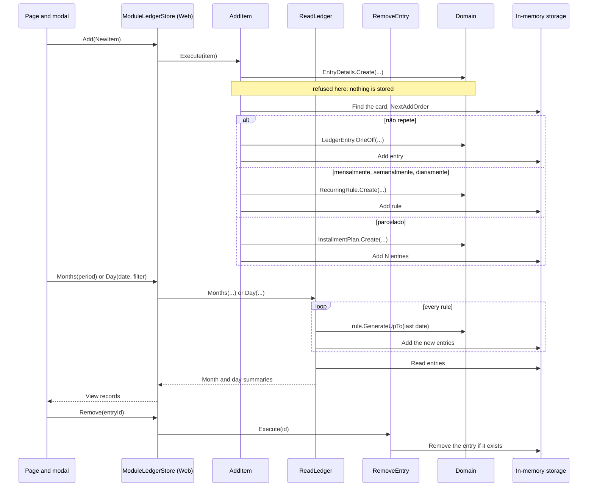
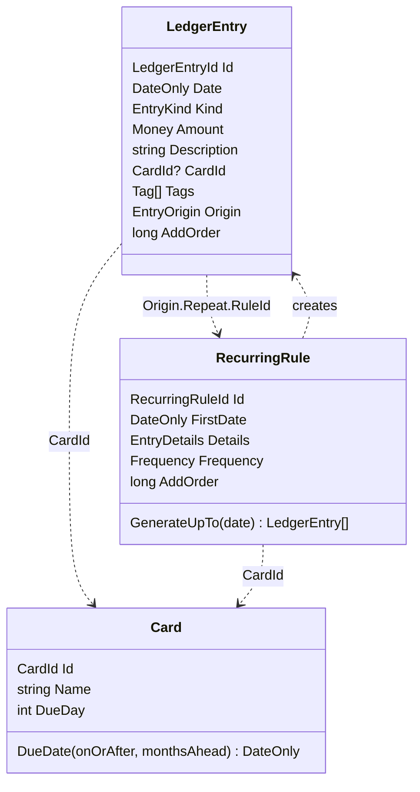

# Ledger Entry Design

**Spec**: `.specs/features/003-ledger-entry/spec.md`
**Status**: Approved

---

## Architecture Overview

`Gibeira.Ledger` is the first finance module (AD-001). The domain holds three aggregates, `LedgerEntry`, `RecurringRule` and `Card`. Application holds the use cases and the ports. Infrastructure holds the in-memory storage and the seed. `Gibeira.Web` keeps `ILedgerStore` as the page's contract and implements it with a thin adapter over the use cases.

### Approaches for connecting the page

All three deliver the same scope. The recommendation is first.

| Approach | Trade-off |
| -------- | --------- |
| **Adapter in Web implements `ILedgerStore` (chosen)** | The page, its view records and its pt-BR labels stay in Web, and only the adapter knows the module. It costs one mapping class. |
| Move `ILedgerStore` and its view records into Application | No adapter, but Application takes on `IsToday`, `IsWeekend` and pt-BR labels, and every component's `Kind` changes. |
| Page calls the use cases directly | Drops one layer, but breaks MOD-04 and every test that stubs `ILedgerStore`. |

### Adding, reading, removing



### DDD building blocks

The user delegated this choice: "I want ddd, but not necessarly all of it. just what makes sense".

| Used | Why |
| ---- | --- |
| Aggregates `LedgerEntry`, `RecurringRule`, `Card` | Each has an identity and its own rules. They reference each other by id only. |
| Value objects `Money`, `Tag`, `EntryDetails`, `EntryOrigin` and the typed ids | They hold the rules that would otherwise be repeated, and they can't exist invalid. |
| Factory methods | The only way to create an aggregate, so an invalid one can't exist. |
| Repository ports in Application | Use cases don't know the storage, so a database can replace it later. |

| Left out | Why |
| -------- | --- |
| Domain events | Nothing subscribes to them, and one module has no one to tell. |
| Domain services | The amount split fits a factory, and the balance is a read over entries. |
| Base `Entity` or `AggregateRoot` classes, and a mediator | Three aggregates don't justify them. Plain classes do the same job. |

---

## Code Reuse Analysis

### Existing Components to Leverage

| Component | Location | How to Use |
| --------- | -------- | ---------- |
| Module template | `templates/module`, `dotnet new gibeira-module -n Ledger` | Creates the three projects with the right references |
| Repetition rules | `src/Host/Gibeira.Web/Mockup/Schedule.cs` | The monthly no-drift `AddMonths` and the installment split move into `RecurringRule` and `InstallmentPlan`; `ScheduleTests` cases move with them |
| Due date rule | `src/Host/Gibeira.Web/Mockup/CardDueDates.cs` | Moves into `Card.DueDate`; `CardDueDatesTests` cases move with it |
| Balance rule | `src/Host/Gibeira.Web/Mockup/LedgerCalculator.cs` | Moves into `LedgerProjection`; its tests move with it |
| Seed items | `src/Host/Gibeira.Web/Mockup/MockSeed.cs` | The same items move into `LedgerSeed`, added through `AddItem` |
| Store behaviour tests | `tests/Gibeira.Web.Tests/Mockup/InMemoryLedgerStoreTests.cs` | Move to `tests/Gibeira.Web.Tests/Ledger/ModuleLedgerStoreTests.cs` with the same assertions |
| Tagged-union style | `Repetition` in `src/Host/Gibeira.Web/Ledger/ILedgerStore.cs:26` | `EntryOrigin` follows the same nested sealed records |
| Test exclusion in arch rules | `tests/Gibeira.ArchitectureTests/SolutionArchitecture.cs:27` | `Gibeira.Ledger.Tests` is skipped by name, like `Gibeira.Web.Tests` |

### Integration Points

| System | Integration Method |
| ------ | ------------------ |
| Dependency injection | `AddLedgerModule()` in `Gibeira.Web/Ledger/LedgerModule.cs`, because "`Gibeira.Web` composes the modules" (`docs/architecture.md`). Infrastructure needs no new package |
| `ILedgerStore` | `ModuleLedgerStore` in `Gibeira.Web/Ledger/`, registered as scoped, so each circuit keeps its own storage and a reload starts from the seed (MOD-06) |
| Architecture tests | `src/Modules/**/*.csproj` is already referenced, so the module is checked with no edit (ARCH-08) |

---

## Components

### Domain: `src/Modules/Ledger/Gibeira.Ledger.Domain/`

Everything is public and immutable except `RecurringRule`'s position. A refusal throws `LedgerRuleException`.

```csharp
public enum EntryKind { Income, Expense, DailySpending, Savings, CreditCard }
public enum Frequency { Monthly, Weekly, Daily }

public readonly record struct LedgerEntryId(Guid Value) { public static LedgerEntryId New(); }
public readonly record struct RecurringRuleId(Guid Value) { public static RecurringRuleId New(); }
public readonly record struct InstallmentPlanId(Guid Value) { public static InstallmentPlanId New(); }
public readonly record struct CardId(Guid Value) { public static CardId New(); }

// Above zero, at most 999.999.999,99, at most two decimals. R$ only.
public sealed record Money
{
    public const decimal Max = 999_999_999.99m;
    public decimal Value { get; }
    public static Money Of(decimal value);
    public static bool CanSplit(decimal value, int parts);   // at least R$ 0,01 per part
    public IReadOnlyList<Money> SplitInto(int parts);        // INS-02: the first carries the remainder
}

public sealed record Tag { public string Name { get; } public static Tag Of(string name); }

// Every rule shared by an entry and the rule that creates it, in one place.
public sealed class EntryDetails
{
    public EntryKind Kind { get; }
    public Money Amount { get; }
    public string Description { get; }
    public CardId? CardId { get; }
    public IReadOnlyList<Tag> Tags { get; }

    public static EntryDetails Create(EntryKind kind, decimal amount, string description, CardId? cardId, IEnumerable<string> tags);
    internal EntryDetails WithAmount(Money amount);
}

public abstract record EntryOrigin
{
    public sealed record OneOff : EntryOrigin;
    public sealed record Repeat(RecurringRuleId RuleId, Frequency Frequency) : EntryOrigin;
    public sealed record Installment(InstallmentPlanId PlanId, int Number, int Count) : EntryOrigin;
}

// Aggregate root. One complete record of one day. Equal by id. Nothing changes after creation.
public sealed class LedgerEntry : IEquatable<LedgerEntry>
{
    public LedgerEntryId Id { get; }
    public DateOnly Date { get; }
    public EntryKind Kind { get; }
    public Money Amount { get; }
    public string Description { get; }
    public CardId? CardId { get; }
    public IReadOnlyList<Tag> Tags { get; }
    public EntryOrigin Origin { get; }
    public long AddOrder { get; }                 // ORD-01

    public decimal BalanceEffect { get; }         // + for Income, - for every other kind

    public static LedgerEntry OneOff(DateOnly date, EntryDetails details, long addOrder);
    internal static LedgerEntry From(DateOnly date, EntryDetails details, EntryOrigin origin, long addOrder);
}

// Aggregate root. Creates the entries of an endless repetition.
public sealed class RecurringRule
{
    public RecurringRuleId Id { get; }
    public DateOnly FirstDate { get; }
    public EntryDetails Details { get; }
    public Frequency Frequency { get; }
    public long AddOrder { get; }

    public static RecurringRule Create(DateOnly firstDate, EntryDetails details, Frequency frequency, long addOrder);

    // The entries from its position up to the date, moving the position forward; none when already there.
    public IReadOnlyList<LedgerEntry> GenerateUpTo(DateOnly date);
}

// Factory for parcelado: N entries at once, with no aggregate of its own.
public static class InstallmentPlan
{
    public const int MinParts = 2;
    public const int MaxParts = 48;
    public static IReadOnlyList<LedgerEntry> Create(DateOnly firstDate, EntryDetails details, int parts, long addOrder);
}

// Aggregate root.
public sealed class Card
{
    public CardId Id { get; }
    public string Name { get; }
    public int DueDay { get; }
    public static Card Create(string name, int dueDay);
    public DateOnly DueDate(DateOnly onOrAfter, int monthsAhead);
}

public sealed class LedgerRuleException(string message) : Exception(message);
```

**`GeneratedUntil`:** the spec's sketch names this field. The rule keeps a private next index instead, because the index alone guarantees no duplicates and no drift, and a date beside it would be a second copy of one fact. AD-008 still holds: the generated range only moves forward.

### Application: `src/Modules/Ledger/Gibeira.Ledger.Application/`

```csharp
// Ports. Storage implements them.
public interface ILedgerEntryRepository
{
    long NextAddOrder();
    void Add(IEnumerable<LedgerEntry> entries);
    void Remove(LedgerEntryId id);                     // nothing happens when it no longer exists
    IReadOnlyList<LedgerEntry> UpTo(DateOnly last);
    IReadOnlyList<LedgerEntry> On(DateOnly day);
}

public interface IRecurringRuleRepository
{
    void Add(RecurringRule rule);
    IReadOnlyList<RecurringRule> All();
}

// Cards and tags are fixed lists for now (spec: Out of Scope).
public interface ILedgerCatalog
{
    IReadOnlyList<Card> Cards { get; }
    IReadOnlyList<Tag> Tags { get; }
    Card? FindCard(CardId id);
}

// What the user adds, before it becomes entries.
public abstract record ItemRepetition
{
    public sealed record None : ItemRepetition;
    public sealed record Recurring(Frequency Frequency) : ItemRepetition;
    public sealed record Installments(int Count) : ItemRepetition;
}

public sealed record NewLedgerItem(
    EntryKind Kind, decimal Amount, string Description, DateOnly Date,
    ItemRepetition Repetition, CardId? CardId, IReadOnlyList<string> Tags);

// Use cases.
public sealed class AddItem(ILedgerEntryRepository entries, IRecurringRuleRepository rules, ILedgerCatalog catalog)
{
    public void Execute(NewLedgerItem item);
}

public sealed class RemoveEntry(ILedgerEntryRepository entries)
{
    public void Execute(LedgerEntryId id);
}

public sealed class ReadLedger(ILedgerEntryRepository entries, IRecurringRuleRepository rules)
{
    public IReadOnlyList<MonthSummary> Months(IReadOnlyList<DateOnly> monthStarts);
    public IReadOnlyList<LedgerEntry> Day(DateOnly day, EntryKind? filter);    // in AddOrder
}

// The balance rule, a pure function over entries. HOME-08 to HOME-13 hold here.
public static class LedgerProjection
{
    public static IReadOnlyList<MonthSummary> Months(IReadOnlyCollection<LedgerEntry> entries, IReadOnlyList<DateOnly> monthStarts);
}

public sealed record DaySummary(DateOnly Date, IReadOnlyDictionary<EntryKind, decimal> Sums, decimal Balance);
public sealed record MonthSummary(DateOnly Month, IReadOnlyList<DaySummary> Days, IReadOnlyDictionary<EntryKind, decimal> Totals);
```

`AddItem` checks in this order, so a refusal stores nothing: `EntryDetails.Create`, the card exists, the repetition's own rules, and only then the repositories.

### Infrastructure: `src/Modules/Ledger/Gibeira.Ledger.Infrastructure/`

| Type | Purpose |
| ---- | ------- |
| `InMemoryLedgerEntryRepository` | A list and a counter |
| `InMemoryRecurringRuleRepository` | A list |
| `InMemoryLedgerCatalog` | Itaú (day 10), Santander (day 6) and the five tags |
| `LedgerSeed.Run(AddItem, ILedgerCatalog, DateOnly today)` | The same items as `MockSeed`, through `AddItem` (MOD-05) |

### Web: `src/Host/Gibeira.Web/`

| Type | Change |
| ---- | ------ |
| `Ledger/ModuleLedgerStore.cs` (new) | Implements `ILedgerStore`. Maps `Kind` to `EntryKind`, adds `IsWeekend` and `IsToday` from `TimeProvider`, and builds the labels `mensalmente`, `parcela 2/10` from `EntryOrigin` |
| `Ledger/LedgerModule.cs` (new) | `AddLedgerModule()`: scoped storage, use cases and store; the store's factory runs the seed |
| `Ledger/ILedgerStore.cs` | `Card` gains `Guid Id`; `NewItem.Card` becomes `Guid? CardId`; `DayEntry.ItemId` becomes `EntryId`; `DueDate` takes the card; `Remove(Guid entryId)` loses its day |
| `Ledger/AddItemForm.cs` | `CanSubmit` adds MDL-02 and INS-06, the latter through `Money.CanSplit`; `Submit` passes `Card?.Id` |
| `Ledger/AmountInput.cs` | `Max` reads `Money.Max`, so the bound has one source |
| `Components/Home/AddItemModal.razor` | `sem cartão` leaves the list (MDL-01); starts with the card list open when the form starts on cartão (MDL-05) |
| `Components/Pages/Home.razor`, `Components/Home/DayDrawer.razor` | `ItemId` becomes `EntryId` |
| Portuguese identifiers across Web and its tests | Renamed to English with no behaviour change (MOD-09, AD-011): `Kind.Entrada` to `Kind.Income` and so on, `DayRow.Saldo` to `Balance`, `.saldo-cell` to `.balance-cell`, `--kind-entrada` to `--kind-income`, `--saldo-positive` to `--balance-positive`, the modal's `"mensal"` keys to `"monthly"`, and test names such as `CartaoOpensCardDropdown`. Strings shown on screens stay pt-BR, and so does the seed's sample data |
| `Mockup/` | Deleted (MOD-03) |
| `Program.cs` | `AddLedgerModule()` replaces the mock store's registration |

---

## Data Models

The aggregates above are the model. They reference each other by id only:



---

## Error Handling Strategy

| Error Scenario | Handling | User Impact |
| -------------- | -------- | ----------- |
| Any refused value (ENT-04 to ENT-11, REP-10, INS-04, INS-05, CARD-02, CARD-03) | `LedgerRuleException` naming the rule | None in normal use: the form never submits one |
| Card that doesn't exist (ADDT-02) | `AddItem` throws `LedgerRuleException` | None: the modal lists only existing cards |
| Removing an entry already gone (DEL-03) | The repository ignores it | None |

---

## Risks & Concerns

| Concern | Location (file:line) | Impact | Mitigation |
| ------- | -------------------- | ------ | ---------- |
| Reading writes: `ReadLedger` adds entries | `ReadLedger` (new) | A read has a side effect, which surprises the next reader of the code | The name and a comment say so; REP-08 proves repeated reads are safe |
| A rule and its new entries are two aggregates changing together | `ReadLedger` (new) | Harmless in memory. With a database, a crash between them would duplicate or lose days | Persistence is out of scope; the persistence feature must save them in one database transaction. AD-008 records the trade-off |
| A daily rule read far ahead creates many entries | `RecurringRule.GenerateUpTo` (new) | About 365 per year per daily rule. A user clicking `>>` many times could slow the page | Accepted: same order as the mockup's expansion. A later end date reduces it |
| Modal hides why the add button is disabled | `AddItemModal.razor` | On cartão with no card, nothing explains it | MDL-05 opens the list from the drawer; the type row reopens it. A hint would be a separate change |
| The rename touches about 27 files | `src/Host/Gibeira.Web`, `tests/Gibeira.Web.Tests`, `tests/Gibeira.IntegrationTests/Browser/HomePageBrowserTests.cs` | A large diff, and a missed CSS class or token can break styles with no compile error | One commit with no behaviour change; the token and Playwright tests catch a missed class or token |
| `Card` and `NewItem` change shape | `tests/Gibeira.Web.Tests/Ledger/AddItemFormTests.cs:8`, `Home/AddItemModalTests.cs`, `Home/HomePageTests.cs:288`, `Home/DayDrawerTests.cs:196` | Tests must change with the signature | Only signatures change; assertions stay, except the ones MDL-01 and MDL-02 replace |
| Web tests create `InMemoryLedgerStore` directly | `tests/Gibeira.Web.Tests/Home/AddItemModalTests.cs:25`, `Home/HomePageTests.cs:19,212` | Deleting the mockup breaks them | A small test helper builds the real store through `AddLedgerModule()`, so page tests run on the real module |

---

## Tech Decisions

| Decision | Choice | Rationale |
| -------- | ------ | --------- |
| Refusals | Exceptions, not a `Result` type | No reachable screen has an error state: the form prevents every refusal, so one reaching the domain is a bug. A `Result` would add a branch at every call with nothing to show |
| Where the ports live | Application | `docs/architecture.md` limits Domain to entities, value objects and rules |
| Ids | Typed record structs over `Guid.CreateVersion7()` | A `CardId` can't be passed as a `LedgerEntryId`; v7 sorts well in a future database |
| Order within a day | Explicit `AddOrder` from the entry repository | A rule's entries are created long after its add, so creation order and v7 ids can't give ORD-01 |
| Sums and balances | `decimal` in the read model, not `Money` | `Money` is above zero by rule; a balance can be zero or negative |
| Money module | Inside `Gibeira.Ledger.Domain`, not `SharedKernel` | One module uses it; move it when a second needs it |
| Web types | Web keeps its own `Kind` and view records, with the same English value names as `EntryKind` | UI components stay free of domain types, and the adapter is the only place that maps them |
| Portuguese in code | One rename task first, with a naming test that fails on the words in the spec's table (MOD-09) | Keeps the renames out of the feature's commits and stops the words coming back. Comments may still quote a screen label |
| Tests | New `tests/Gibeira.Ledger.Tests` for Domain, Application and Infrastructure | Domain rules are proven with no page; the adapter stays tested in `Gibeira.Web.Tests` |
